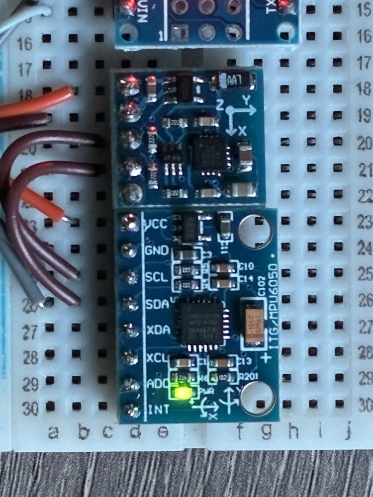

# SatPointer

Shows where the board is pointing, in the terms used to aim a satellite dish,
and tells you which way to turn to reach a target you dial in.

- **azimuth**: true bearing, 0° = north, 90° = east, measured clockwise
- **elevation**: angle above the horizon, from −90° to +90°
- **roll**: rotation around the pointing direction

The pointing direction is the beam, which is whichever device axis the
**beam mount** setting names — by default the +X arrow printed on the GY-521.



Ported from the Arduino Nano sketch in `docs/original-nano/` to an
ESP-12F with an OLED and a rotary encoder. The sensor maths is unchanged.

## Hardware

| Part | Chip | I2C address |
|---|---|---|
| ESP-12F on a USB-UART adapter | ESP8266EX, 4MB flash | |
| GY-521 | MPU6050 (accelerometer) | 0x68 |
| GY-271 | QMC5883L (magnetometer) | 0x0D |
| 0.96" OLED | SSD1306 128×64 | 0x3C |
| EC11 rotary encoder + button | | |

All three I2C devices share one bus:

| Signal | ESP-12F |
|---|---|
| SDA | GPIO4 |
| SCL | GPIO5 |
| VCC | **3.3V** |
| GND | GND |

| Encoder | ESP-12F |
|---|---|
| A | GPIO13 |
| B | GPIO14 |
| button | GPIO0 |
| common (middle pin of the 3-pin side) | GND |

The quadrature section and the push switch have **separate grounds**. With the
common pin floating the button still works perfectly while the dial does
nothing at all, because the internal pullups hold A and B high and no edge ever
reaches the interrupt. Send `e` to check: if A and B do not change as you turn,
that is the cause. On a KY-040 breakout, its **+** pin must also be powered,
since its pullups are on the module.

**The ESP8266 is not 5V tolerant.** The original Nano wiring ran both sensor
modules from 5V; on this board they must be on 3.3V.

**GPIO0 is the boot strapping pin.** Holding the encoder button down through a
reset enters the flash bootloader instead of the app — which is convenient, it
doubles as a proper flash button, but it means the button must idle high.

Boot pins on the bare module: EN (CH_PD) → 3.3V, GPIO15 → GND, GPIO2 floating.
Use a 3.3V adapter that can source ~300mA peak; cheap breakouts brown out
mid-flash.

**Sensor mounting:** both sensor modules lie flat on the board, with the
GY-271's **Y** arrow pointing the same way as the GY-521's **X** arrow. That
relationship is fixed in `ACC_AXIS` / `MAG_AXIS` in `src/orientation.cpp`;
change it only if you rearrange the modules relative to each other.

**Beam mounting** — which way round the whole device clamps to the beam — is a
runtime setting, see below.

Some GY-271 boards carry an HMC5883L (0x1E) or a QMC5883P (0x2C) instead, which
this code does not support. The I2C scan printed at every boot names whichever
is fitted and flags anything unexpected on the bus.

## Beam mount

The beam points along one of four device axes. Press `m` to cycle; the current
one shows in the status row and in `p` output.

| Mount | Beam axis | Device orientation |
|---|---|---|
| `top` | +Y | beam out the left face |
| `left` | −X | beam out the back |
| `right` | +X | beam out the front (default) |
| `down` | −Z | beam out the bottom, screen faces up |

Axes are the board frame: X = the GY-521's printed +X arrow, Y = left, Z = up.
Internally the sensor vectors are rotated into a canonical frame where the beam
is +X, so the fusion maths never sees the mount setting — `right` is the exact
identity.

**Changing the mount means recalibrating.** Hard/soft-iron correction is in
sensor frame and survives moving the sensor relative to itself, but clamping to
a different face of a metal beam changes the surrounding ferrous mass entirely.

## Build and flash

```sh
pio run -t upload                 # build and flash
python3 tools/monitor.py          # serial capture (clears DTR; see below)
```

Source layout:

| File | Holds |
|---|---|
| `main.cpp` | setup/loop, sample and draw scheduling |
| `config.h` | pins, addresses, timing constants |
| `sensors.*` | I2C bus, MPU6050 and QMC5883L reads, boot scan |
| `orientation.*` | mount table, frame remap, sensor fusion |
| `calibration.*` | magnetometer min/max calibration |
| `display.*` | SSD1306 rendering |
| `input.*` | encoder and button |
| `commands.*` | serial commands and the data line |
| `settings.*` | the persisted `Settings` struct |

`upload_port` is pinned in `platformio.ini`. For a 0.91" panel change
`-D OLED_H=64` to `32`.

If an upload fails with `Timed out waiting for packet header`, hold the encoder
button (or ground GPIO0) while the board resets, upload, then release it.

## Use

The display shows current and target angles, and what to do about the
difference:

```
AZ  90.2 -> 145.0
EL  -1.5 ->  28.5
--------------------
turn RIGHT     54.8
raise          30.0

[AZ]  el     cal ok
```

- **turn the encoder** to move the target
- **press** to switch between editing azimuth and elevation — the bracketed
  label shows which is live
- **hold** for 0.8s to open the menu

## Menu

Hold the button to open it, turn to choose, press to activate, hold to go back.

| Item | Does |
|---|---|
| Calibrate | starts magnetometer calibration — press to save, hold to abandon |
| Mount | pick the beam mount; turn to preview, press to apply, hold to cancel |
| Clear target | zeroes both targets |
| Exit | back to the guidance screen |

The mount picker previews without committing, so turning past the one you want
costs nothing. Applying a mount resets the sensor filter and warns that the
magnetometer calibration no longer holds.

Calibration is the same whether started from the menu or by sending `c`, so
either can finish it.

The target is saved to EEPROM two seconds after you stop turning, so a sweep of
the dial costs one flash write rather than one per detent.

Serial at **115200** prints 10 lines per second, as `label:value` pairs so the
Serial Plotter can graph them:

```
elev:-1.5 az:90.2 daz:54.8 del:30.0 roll:0.8 dip:65.3 B:52.1
```

| Field | Meaning |
|---|---|
| `elev` | elevation of the beam |
| `az` | true azimuth of the beam |
| `daz` | degrees to turn to reach the target; positive = clockwise |
| `del` | degrees to raise to reach the target |
| `roll` | rotation around the beam; positive when the right side is down. This is dish skew. |
| `dip` | magnetic dip angle. Should hold constant while the device is still; if it moves when it is not being handled, the axis mapping is off. |
| `B` | field strength in µT. Earth's is 25–65; much more means something magnetic is nearby. |

## Calibration (do once)

The magnetometer needs calibrating, because the module headers and anything
steel nearby bend the magnetic field. Do it with everything mounted exactly as
it will be used. Until it is done the display shows **NO CAL** and azimuth
should not be trusted.

1. **Magnetometer:** menu → Calibrate (or send `c`), slowly rotate the board
   through *every* orientation for 30–60 seconds including upside down, then
   press (or send `c` again). The display shows the swing collected on each
   axis and the sample count while this runs.

   **Calibrate in the exact final configuration, cables included.** Hard-iron
   offsets belong to the surrounding metal, so a calibration done with the UART
   unplugged does not transfer to running with it plugged in.

   The result is graded, not assumed. The device applies the fit back to the
   samples it kept and measures how constant the corrected field magnitude
   comes out; Earth's field is locally constant, so any remaining variation is
   fit error. Under 3% standard deviation counts as calibrated and the status
   slot reads `ok N%`; above it reads `BAD N%` and azimuth is not trusted.

   |B| is used rather than dip because dip also needs the accelerometer's idea
   of down, so handling acceleration corrupts it and it cannot tell a bad fit
   from someone waving the device about.
2. **North:** point the beam at a known true bearing and send it. `n90`
   means it points east, `n` means north. This also absorbs magnetic
   declination.

Both are saved to EEPROM and survive a restart.

| Command | Action |
|---|---|
| `c` | start / finish magnetometer calibration |
| `x` | abandon a calibration in progress |
| `nDEG` | the beam is currently pointing at true bearing DEG |
| `m` | cycle the beam mount (top / left / right / down) |
| `r` | switch raw sensor output on or off |
| `e` | print encoder pin states, for the wiring check above |
| `p` | print stored settings |
| `z` | erase settings |
| `h` | help |

## How it works

At rest, the accelerometer tells which way is down (**D**), and the
magnetometer gives the magnetic field (**M**). From those two vectors:

- **East** = D × M
- **North** = East × D

Taking the beam's components along north, east and down gives azimuth
`atan2(E, N)` and elevation `asin(−D)`. This works however the board is tilted.
Both sensor vectors are smoothed with a simple low-pass filter.

## Status

Verified on hardware 2026-09-22: both sensors read (field 46 µT, well inside
Earth's range), EEPROM load/store works, the encoder counts and its target
persists, and the button toggles the edited axis cleanly.

Phase-1 refactor and beam mount verified on hardware 2026-09-23: all four
mounts produce the angles geometry requires (beam reversed flips elevation and
swings azimuth 180°, the side face reads ~0° elevation and 90° round, the
bottom face reads 90° below the front), cycling returns to the start value, and
dip and field strength — both rotation invariants — hold constant across all
four, so the remap does not corrupt the magnetic vector.

Not yet verified:

- **Encoder direction.** Counting works, but which way clockwise moves the
  target was never confirmed. If it is inverted, swap `PIN_ENC_A` and
  `PIN_ENC_B`.
- **The OLED rendering.** It enumerates at 0x3C and `display.begin()` succeeds,
  but nobody has confirmed the layout looks right on the panel.
- **Calibration quality.** One calibration has been run and stored, but it was
  done with the UART unplugged and then measured with it plugged in, and scored
  badly (|B| varying 11% peak-to-peak). It needs redoing in the final cable
  configuration. The grading that would have caught this is now in the firmware
  but has not yet graded a real attempt — only simulated ones.

## Limitations

- Azimuth isn't meaningful when +X points nearly straight up or down.
- Readings are only correct while the board is still or moving slowly. Shaking
  adds acceleration on top of gravity, which throws off the accelerometer. A
  gyro filter would fix that; the MPU6050 has a gyro, but this code doesn't use
  it yet.
- Recalibrate if you add or move anything metal or magnetic near the GY-271.

## Serial capture quirk

**Set `dtr = False` before reading, or the port goes silent.** Opening the port
with pyserial's defaults produced zero bytes at 115200 while the ROM bootloader
was visible at 74880 — i.e. the chip sat in flash mode instead of running the
app. Clearing DTR fixed it every time. `tools/monitor.py` does this; use it
rather than a bare `pio device monitor`, which also never exits on its own and
macOS has no `timeout` command to stop it.

Pulsing RTS does **not** reset this board — uptime kept climbing straight
through the attempts — so the boot banner can only be caught right after an
upload, or by resetting the board by hand. What is actually wired to DTR/RTS on
this adapter has not been established; the above is the observed behaviour, not
a schematic.

Boot output starts with garbage: the ROM bootloader talks at 74880 baud before
the sketch's 115200 banner. That's expected.
